# How I tested and hardened my Ubuntu server

I used two Ubuntu VMs in VirtualBox. I ran the server checks over SSH, tested the server from the client, and ran Docker on the desktop VM. The terminal captures below are from my runs. I’ve included the commands that explain each result and labelled the charts separately.

## 1. Identify the server and its files

From the desktop I logged in with `ssh yasin@10.0.2.3`. In the remote shell, `echo "$SSH_CONNECTION"` showed the client address, the server address and destination port 22. I used this check because both machines showed the same shell prompt.

On the server I ran `ls -l /` and `tree -L 1 /` to inspect the directory layout. I then used `stat /etc/passwd` to check ownership and permissions. Its mode was 0644, so only root could write to it. I compared hard and symbolic links by inode. The two hard links shared inode 917515. The symbolic link had its own inode, 917516.

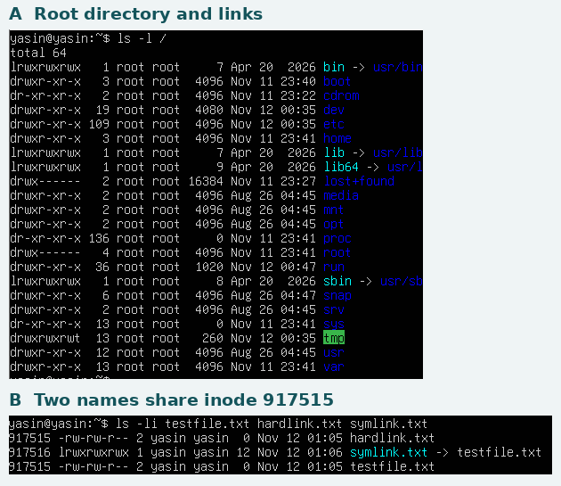

## 2. Check capacity and file allocation

I used three commands because free bytes, free inodes and mount settings answer different questions.

```bash
df -hT /
df -i /
findmnt /
```

The root filesystem was ext4 on `/dev/sda2`. It had 20 GiB free and had used 10% of its inodes. A workload creating many tiny files could run out of inodes while there was still disk space available.

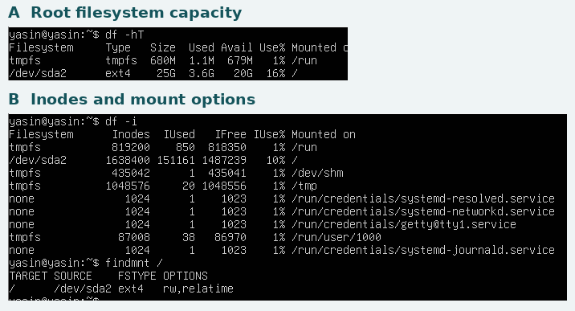

## 3. Measure the effect of caching

I used `dd` to write a 1 GiB file in 1 MiB blocks with `oflag=direct`. I cleared the guest cache, read the file, then read it again immediately. The write took 10.66 seconds at 101 MB/s. The first read took 3.31 seconds at 324 MB/s and the repeat took 0.96 seconds at about 1,100 MB/s. The host could still have cached data during the first read.

I watched the device with `iostat -x 1` and identified the process doing the work with `iotop`. The sample showed 8.50 ms write latency and 42.57% utilisation. I would need a longer observation to tell whether the disk was a bottleneck.

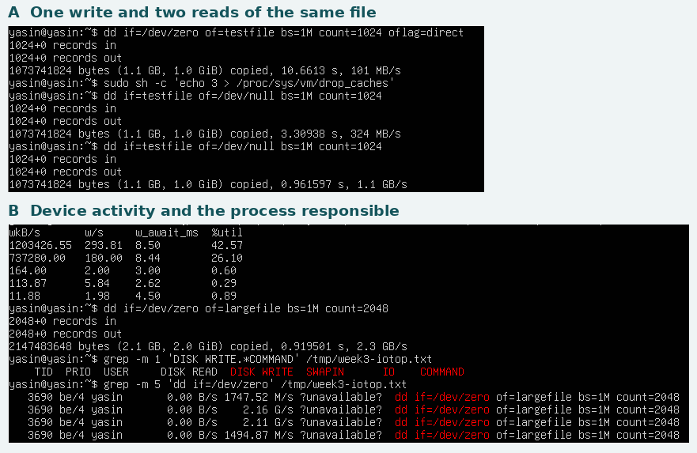

## 4. Compare idle, CPU and memory workloads

On the server I installed `stress` and Apache. I took three idle samples over five minutes, then ran two CPU workers on the two virtual CPUs. For memory I used two workers allocating 512 MiB each. I checked CPU with `vmstat` and `sar`, and compared memory with `free` before and during allocation.

The CPU sample reached 100%. My first memory sample missed the allocation, so I held the workload longer. The paired readings below show memory rising from 496 to 1,513 MiB. The CPU run requested 120 seconds but lasted 310 seconds and produced watchdog warnings, which limits comparisons across these runs.

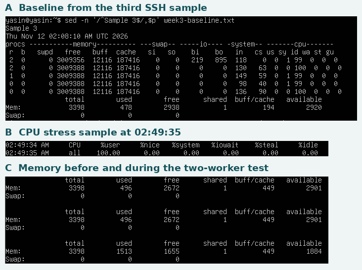

## 5. Send web traffic from the desktop

I installed `apache2-utils` on the client and used ApacheBench against the lab server. I sent 1,000 requests per run and changed the number of concurrent requests with `-c`.

| Concurrent requests | Requests per second | Mean time per request |
| --- | ---: | ---: |
| 10 | 1,728.67 | 5.785 ms |
| 50 | 2,751.67 | 18.171 ms |
| 100 | 5,461.50 | 18.310 ms |

All three runs finished in under a second with zero failed requests. I also ran a timed test at concurrency 50. Apache served 64,542 requests in that test, with kernel CPU at 88.68% and idle time at 0.77%.

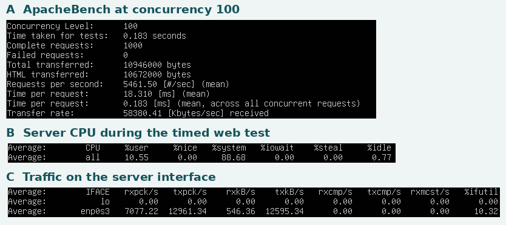

I plotted the workload samples together so I could see where each one put pressure on the VM. The last panel shows network traffic at idle. I would use equal sampling windows for a repeat.

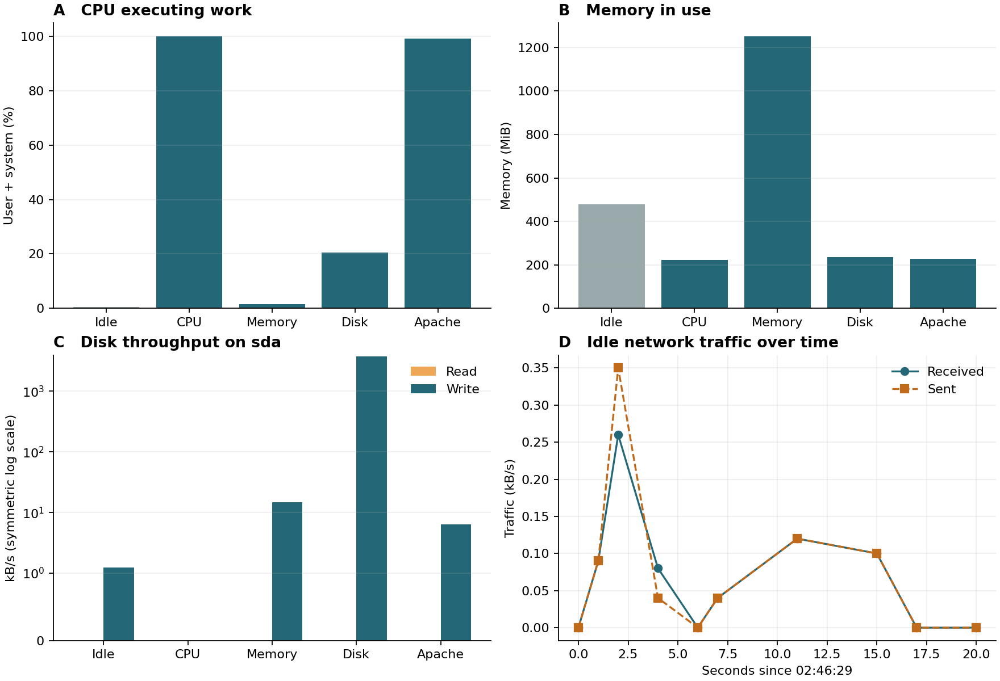

## 6. Audit the server before making changes

I saved the first Lynis report as `lynis-pre.dat`. From the desktop I ran `nmap -p- -sV 10.0.2.3` to see which TCP services another machine could reach. On the server I used `sudo ss -tulnp` to identify local listeners and checked UFW. The firewall was inactive. SSH on port 22 was essential for administration. Apache on port 80 was left over from benchmarking.

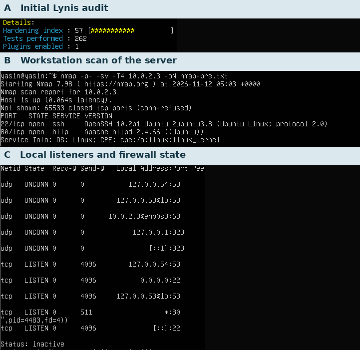

## 7. Apply hardening and check the live settings

I took a VM snapshot, disabled Apache and ModemManager, and configured the firewall to allow SSH. I added `noexec` for `/dev/shm` in `/etc/fstab`. My first check showed the running mount still allowed execution, so I remounted it and checked again.

```bash
findmnt -no TARGET,OPTIONS /dev/shm
sudo find / -xdev -type f -perm -0002
sudo find / -xdev -type f -perm /6000
```

The live mount showed `noexec`, `nodev` and `nosuid`. On the root filesystem I found zero world writable regular files and 21 regular files with the SUID or SGID bit set.

I set a minimum password length of 12 and required an uppercase letter, a lowercase letter, a digit and a symbol. I used `chage` for my existing account with a 90 day maximum, a one day minimum and seven days’ notice. I then checked auditd. The service was active, but `sudo auditctl -l` showed no rules. Monitoring writes and attribute changes to `/etc/passwd` and `/etc/ssh/sshd_config` was my proposed follow up.

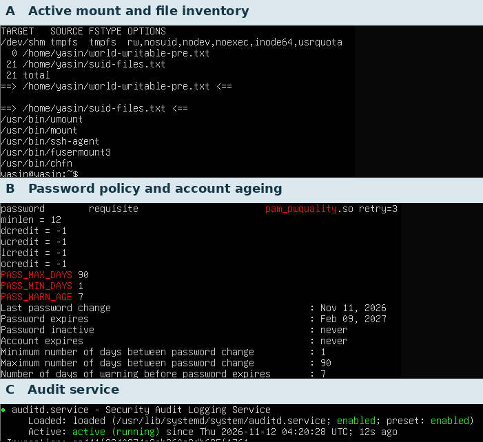

## 8. Repeat the audit and scan

I saved the second Lynis report as `lynis-post.dat` and compared the findings. Six suggestions cleared and one new finding appeared for the empty audit ruleset. The vulnerable package warning remained.

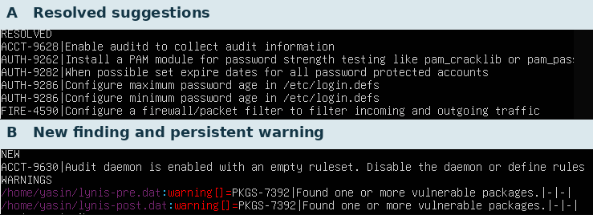

| Check | Before | After |
| --- | ---: | ---: |
| Lynis hardening index | 57 | 61 |
| Tests completed | 262 | 266 |
| Warnings | 1 | 1 |
| Suggestions | 50 | 45 |
| Enabled service units | 52 | 50 |
| Reachable TCP ports | 22, 80 | 22 |

Repeating the scan from the desktop gave me the clearest result. SSH was still reachable and HTTP had closed. I applied several changes between the two audits, so I can only attribute the four point improvement to the combined changes.

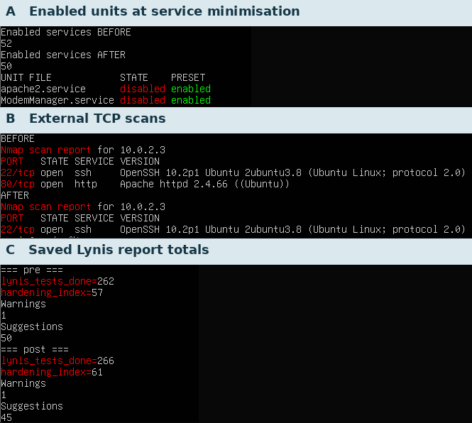

## 9. Compare a container with its host

Back on Ubuntu Desktop I installed Docker and curl, checked that the Docker service was active and ran the hello world image as `hello-lab`. I compared `sudo docker ps` with `sudo docker ps -a`. The container printed its message and exited with code 0, so it appeared in the second listing.

I then opened Bash inside an Ubuntu 22.04 container and compared `uname -r` and `ps aux` inside and outside it. Both environments reported kernel `7.0.0-43-generic`. Inside I saw Bash as PID 1 and the process listing itself. The VM had 184 processes.

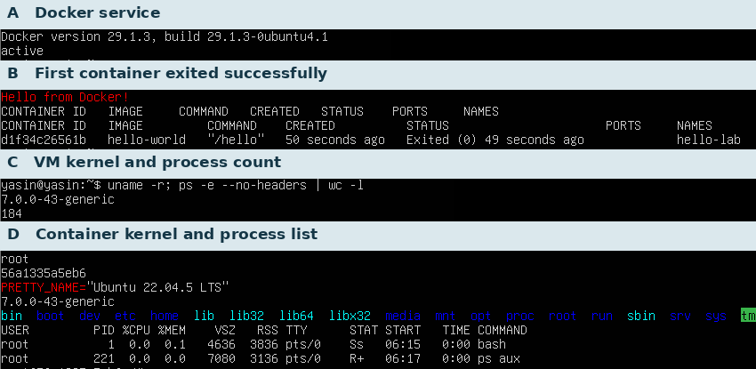

## 10. Publish two web containers and build my own image

I ran Nginx with host port 8080 mapped to container port 80. A second container could also listen on its own port 80, but trying to claim the same host port caused a conflict. I mapped the second to 8081 and used curl on both ports. Each returned the Nginx welcome page.

I built `sysinfo:1.0` from Ubuntu 22.04 with `procps` and my shell script. The build succeeded, but running it exposed a malformed startup command. I changed the Dockerfile line to `CMD exec /bin/bash /usr/local/bin/info.sh`, rebuilt and checked the output.

```bash
sudo docker build -t sysinfo:1.0 .
sudo docker run --rm sysinfo:1.0
sudo docker history sysinfo:1.0
```

The script printed the container hostname, kernel, four processes and memory use. I then changed the hostname label in the script and built version 1.1. Docker reused the package installation layer and rebuilt from the step that copied the changed script.

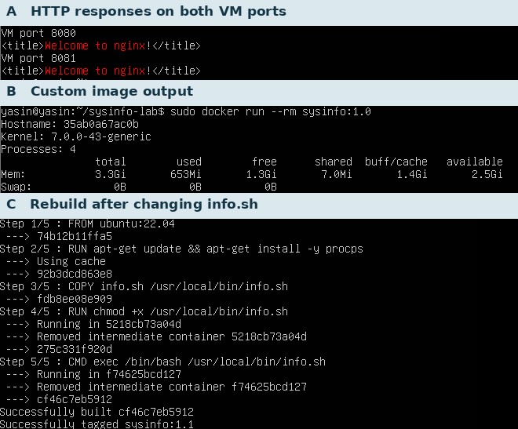

## 11. Test Docker CPU limits and check the measurements

After the VM stalled I used one virtual CPU throughout this comparison and stopped both Nginx containers. I ran the same busy loop three times, with Docker CPU limits of 0.25, 0.50 and 1.00. For each limit I waited ten seconds, then took three readings with `docker stats --no-stream` about five seconds apart.

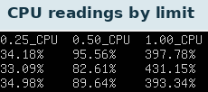

| CPU limit | Reading 1 | Reading 2 | Reading 3 | Mean reported usage |
| --- | ---: | ---: | ---: | ---: |
| 0.25 | 34.18% | 33.09% | 34.98% | 34.08% |
| 0.50 | 95.56% | 82.61% | 89.64% | 89.27% |
| 1.00 | 397.78% | 431.15% | 393.34% | 407.42% |

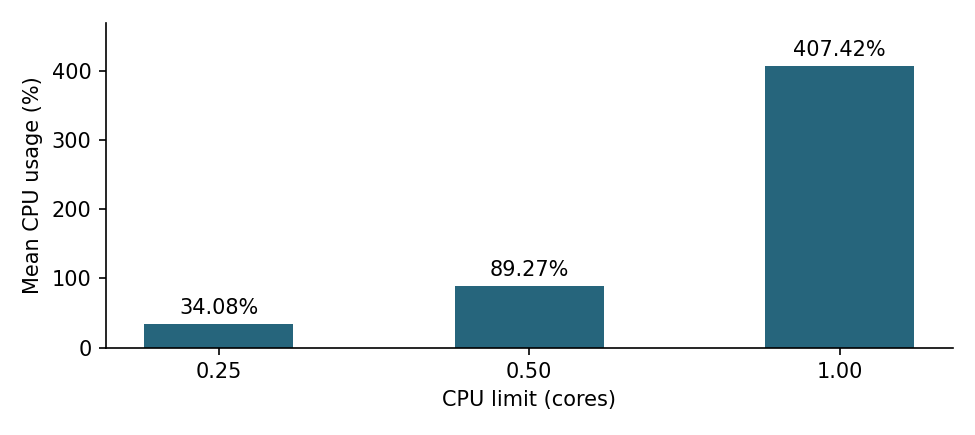

The readings rose with the configured limit, but a single busy loop cannot sustain 407.42% CPU on a VM with one virtual CPU. Given the timing stalls, I wouldn’t use these numbers to predict performance. My next test would use a stable host, a longer sampling window and a comparison of CPU time against elapsed time.
